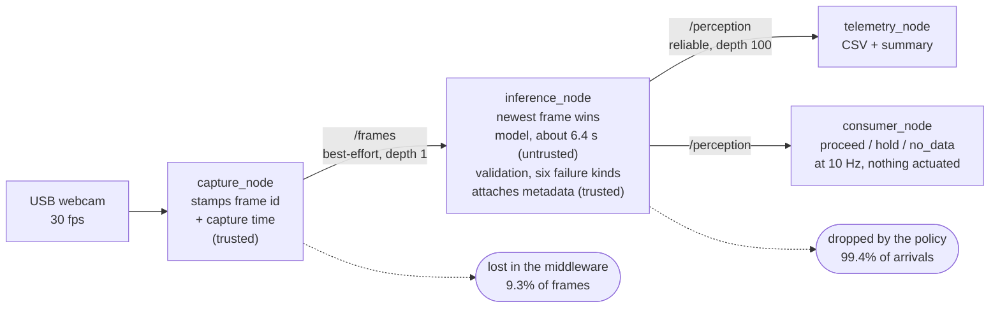

# Edge Multimodal Perception on Constrained Robotics Compute

A perception pipeline built around a model that is **slower than its own camera**.

The camera gives 30 frames a second. A vision-language model (SmolVLM2 2.2B) on
an 8 GB Jetson Orin Nano Super takes about six seconds for one. That is a 183x overload, all the time. This
project is about what the system does in that state: which frames it serves,
how old each answer is, and what it reports when the model gets it wrong.

https://github.com/user-attachments/assets/32bd4b1f-f9e8-415e-b143-26a3918eb061

Top: the live camera. Each line below it is one answer. `if queued (calc.)` is
arithmetic on the real publish times, not a second pipeline.

The model is slow on purpose. A small detector would be better at spotting
obstacles, and this does not propose a VLM for that job. It stands in for any
expensive step a robot runs now and then. This is also not a benchmark. It is
a two-week personal project in Python and ROS 2, tagged `v0.1`.

## What it does

- **Serves the newest frame and drops the rest.** A camera cannot be slowed
  down, so this is admission control, not backpressure: the only choice is
  which frames to take. An old answer is worse than
  none, because nothing in "path clear" says how old the view was.
- **Stamps every answer with metadata the model never touches.** A frame id and
  four timestamps, all from one monotonic clock. Confidence is refused: a model
  that says "high" has produced a word, not a probability.
- **Names every failure.** Six kinds: `malformed_json`, `schema_violation`,
  `unusable_semantics`, `inference_timeout`, `engine_error`, `pipeline_error`.
  Each is published as an explicit `unknown` with its cause. Nothing is retried.
- **Counts two kinds of loss apart.** Frames the middleware lost, and frames
  the policy dropped on purpose.
- **Checks age before meaning.** The consumer falls back on a timer when its
  newest answer gets too old, even if nothing new has arrived.

A real record, from the demo run. The model contradicted itself, so the
meaning is `unknown`, the cause is named, and the frame id and times are intact:

```json
{
  "frame_id": 7625,
  "capture_ts": 52621.484, "inference_start_ts": 52621.519,
  "inference_end_ts": 52627.405, "publish_ts": 52627.406,
  "semantic": { "path_status": "unknown", "obstacle_location": "unknown" },
  "validation": { "ok": false, "failure": "unusable_semantics" }
}
```

## Results

**Result age** is the headline metric: the time from capturing a frame to
publishing its answer. It is what a consumer experiences.

Three admission policies under the same overload, 240 s each:

| policy | captured | published | drop rate | result age p50 | p90 | max |
|---|---|---|---|---|---|---|
| `latest` | 7155 | 39 | 99.4% | **6.123 s** | 6.361 s | 7.919 s |
| `fifo_bounded(8)` | 7198 | 40 | 99.3% | 54.798 s | 55.185 s | 55.354 s |
| `fifo_unbounded` | 7198 | 40 | 0.0% | 121.312 s | 218.572 s | 243.046 s |

`SIMULATED`. The policies are the real code. The engine is a stand-in set to
the 6.09 s measured on the board. `latest` and the bounded queue drop the same
99% of frames and publish the same number of answers. One answer is 6 s old
and the other is 55 s. Both ages were predicted on paper before the run:
6.117 s and 54.76 s. Every captured frame is accounted for exactly, and no p99
is quoted, because below 100 samples a p99 is just the maximum.

```bash
python3 tools/run_overload_sim.py --duration 240 --latency 6.09 --sigma 0.02 --deadline 15
```

Measured on the Jetson over ten minutes, 94 answers:

| | measured | budget |
|---|---|---|
| result age p50 | **6.464 s** | 6.5 s |
| result age p90 | 6.485 s | 6.6 s |
| drift, first minute to last | 0.34% | 10% |
| invalid output | 10% of ten varied frames | 35% |
| frames dropped by the policy | 99.4% of those that arrived | |
| frames lost in the middleware | 9.3%, counted separately | |
| pipeline overhead | 12 ms per 6.4 s cycle | |

The targets are a budget, not an SLO: they come from what the board was
measured doing, not from a requirement. Scene content moves latency too. The
model took 6.09 s on a sparse frame and 6.36 s on a rich one, because a richer
scene gets a longer answer.

Where the six seconds go, from three baselines and no profiler:

| stage | time | share |
|---|---|---|
| processor, CPU | 0.267 s | 4.2% |
| **prefill, GPU** | **4.090 s** | **64.4%** |
| decode, GPU | 2.002 s | 31.5% |

The prediction that prefill dominates was written down first, and it held.
Nothing was optimised, because every fix for prefill changes what the model
sees and would undo the fixed settings the other numbers rest on.

The most useful bug: the pipeline looked 25% slower than the standalone
baseline. Three hypotheses were tested and ruled out. The cause was the
baseline tool, which fed the model a 640x480 image while the pipeline fed it
448x448. Measured the same way, the gap is 0.8%.
[`docs/PERFORMANCE.md`](docs/PERFORMANCE.md) has the method and the other
wrong turns.

## Architecture



Four ROS 2 nodes over a plain-Python core. `/frames` is best-effort because
losing a stale frame is the design. `/perception` is reliable because a lost
answer would skew the statistics. [`docs/ARCHITECTURE.md`](docs/ARCHITECTURE.md)
covers the rest.

## Run it

The core needs Python 3.10+ and nothing else. No GPU, camera or ROS.

```bash
git clone https://github.com/vivh3/edge-inference-pipeline.git
cd edge-inference-pipeline

python3 tools/run_overload_sim.py --duration 12 --latency 0.4    # quick look
pip install -e '.[dev]' && python3 -m pytest tests/ -q           # tests
```

On a Jetson, start with [`docs/SETUP-jetson.md`](docs/SETUP-jetson.md).

## Where things are

```
inference/   the core: admission policies, output contract, pipeline
telemetry/   metrics and CSV/JSON output
tools/       one script per measurement
ros2_ws/     four thin ROS 2 nodes over the core
tests/       the contract, the policies, the failure paths
results/     committed measurements; demo/ holds two terminal recordings
docs/        ARCHITECTURE, PERFORMANCE, SETUP-jetson, DEMO, LIMITATIONS
```

CI runs the tests, runs the simulation from a fresh clone, and fails if the
numbers on this page drift from the files in `results/`.

## Versions

| component | version |
|---|---|
| Python (core) | 3.10+, standard library only |
| JetPack / L4T | 6.2 / R36.4.3 |
| model id + revision/SHA | `HuggingFaceTB/SmolVLM2-2.2B-Instruct` @ `482adb5` |
| model licence | Apache 2.0, [model card](https://huggingface.co/HuggingFaceTB/SmolVLM2-2.2B-Instruct) |
| inference runtime | PyTorch 2.8.0, transformers 5.18.0 |
| baseline inference latency | 6088 ms p50, 6119 ms max (15W, float16) |
| overload ratio, measured | 183x against a 33.3 ms frame period |
| ROS 2 | Humble (Gate 2) |
| power profile | `nvpmodel` mode 0 (15W), held for every measurement |
| camera | j5create JVCU100, MJPG 640x480, measured 30.027 fps |

## Limits

Not real-time, not a safety function, and the policy comparison is simulated.
The invalid-output rate rests on ten frames. ROS 2 use is plumbing plus one
QoS decision. The full list, and what would have to exist before output like
this could move an actuator, is in [`docs/LIMITATIONS.md`](docs/LIMITATIONS.md).

## Licence

MIT, see [`LICENSE`](LICENSE). The model weights are Apache 2.0.
